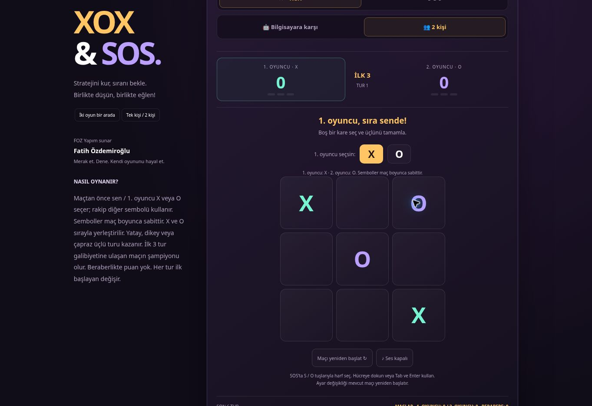
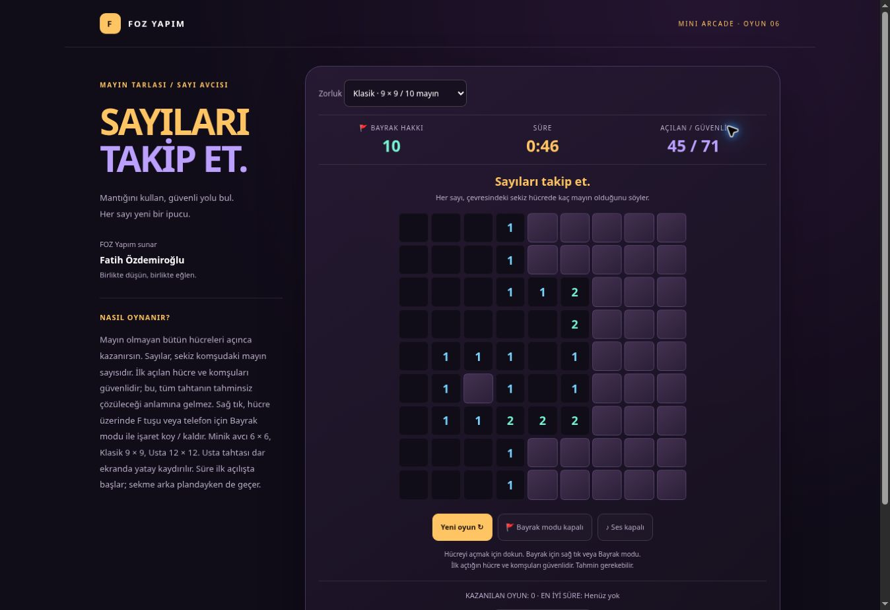
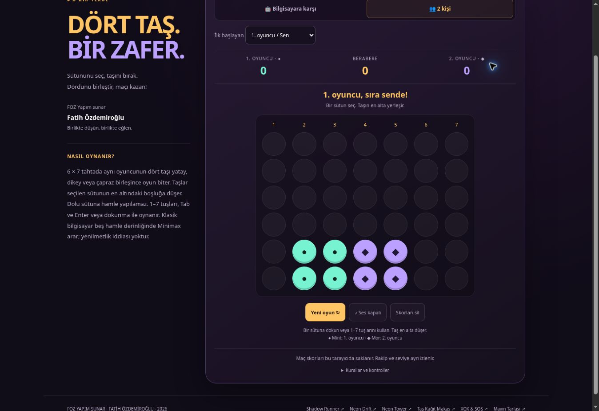

# Fatih Özdemiroğlu

Internal audit & process improvement consultant. Building business software with **FOZ Analytics** and games for all ages with **FOZ Yapım**.

## 🎮 FOZ Yapım — Oyunları tarayıcıda oyna

**Oynamak için “▶ Oyna” bağlantısına veya oyun görseline tıkla.**

Ücretsiz · İndirme veya kurulum yok · GitHub hesabı gerekmez · Telefon ve bilgisayarda oynanır

| Oyun | Hemen oyna |
| --- | --- |
| 🏃 **Shadow Runner — Demir’in Macerası** | **[▶ Oyna](https://fozdemiroglu.github.io/shadow-runner/)** |
| 🏎️ **Neon Drift** | **[▶ Oyna](https://fozdemiroglu.github.io/neon-drift/)** |
| ✨ **Neon Tower** | **[▶ Oyna](https://fozdemiroglu.github.io/neon-tower/)** |
| ✊ **Taş Kağıt Makas** | **[▶ Oyna](https://fozdemiroglu.github.io/tas-kagit-makas/)** |
| 🧩 **XOX & SOS** | **[▶ Oyna](https://fozdemiroglu.github.io/tas-kagit-makas/xox-sos/)** |
| 🚩 **Mayın Tarlası / Sayı Avcısı** | **[▶ Oyna](https://fozdemiroglu.github.io/tas-kagit-makas/mayin-tarlasi/)** |
| 🔵 **4’ü Bir Yerde** | **[▶ Oyna](https://fozdemiroglu.github.io/tas-kagit-makas/dordu-bir-yerde/)** |

### Shadow Runner

Demir’in Macerası: engelleri aş, yıldızları topla ve özel aile finaline ulaş. Minik koşucu üç canla başlar; Klasik mod orijinal macerayı sunar.

**[▶ Shadow Runner OYNA](https://fozdemiroglu.github.io/shadow-runner/)** · [Kaynak kodları](https://github.com/fozdemiroglu/shadow-runner)

---

### Neon Drift

Neon yollarda sür, elmasları topla ve trafikten kaç. İkinci turda su birikintileri ve şerit değiştiren araçlara dikkat!

**[▶ Neon Drift OYNA](https://fozdemiroglu.github.io/neon-drift/)** · [Kaynak kodları](https://github.com/fozdemiroglu/neon-drift)

---

### Neon Tower

Otomatik zıplayan kaşifi yönlendir; hareketli, kırılan ve yaylı platformlarla yüksel.

**[▶ Neon Tower OYNA](https://fozdemiroglu.github.io/neon-tower/)** · [Kaynak kodları](https://github.com/fozdemiroglu/neon-tower)

---

### Taş Kağıt Makas

Büyük ✊ ✋ ✌️ düğmeleriyle bilgisayara meydan oku! İlk üç galibiyete ulaşan kazanır. Neon skor tabelası, geri sayım animasyonu ve kazanınca konfeti.

**[▶ TAŞ KAĞIT MAKAS OYNA](https://fozdemiroglu.github.io/tas-kagit-makas/)** · [Kaynak kodları](https://github.com/fozdemiroglu/tas-kagit-makas)

---

### XOX & SOS

İki oyun bir arada: bilgisayara karşı veya aynı cihazda iki kişi. XOX’ta ilk üç galibiyet, SOS’ta her yeni SOS’a puan ve ek hamle. Minik stratejist ve Klasik seviyeleri; 3×3 Mini, 4×4, 5×5 ve 6×6 SOS tahtaları.

**[▶ XOX & SOS OYNA](https://fozdemiroglu.github.io/tas-kagit-makas/xox-sos/)** · [Kaynak kodları](https://github.com/fozdemiroglu/tas-kagit-makas/tree/main/xox-sos)

---

### Mayın Tarlası / Sayı Avcısı

Sayıları takip et, tüm güvenli hücreleri aç. İlk açılış ve komşuları güvenli; üç zorluk, telefon için bayrak modu, süre ve yerel rekorlar.

**[▶ MAYIN TARLASI OYNA](https://fozdemiroglu.github.io/tas-kagit-makas/mayin-tarlasi/)** · [Kaynak kodları](https://github.com/fozdemiroglu/tas-kagit-makas/tree/main/mayin-tarlasi)

---

### 4’ü Bir Yerde

Taşını bırak, dördünü yatay, dikey veya çapraz birleştir. Bilgisayara karşı kolay/klasik seviye ya da aynı cihazda iki kişi; başlangıç oyuncusu seçimi ve maç skorları.

**[▶ 4’Ü BİR YERDE OYNA](https://fozdemiroglu.github.io/tas-kagit-makas/dordu-bir-yerde/)** · [Kaynak kodları](https://github.com/fozdemiroglu/tas-kagit-makas/tree/main/dordu-bir-yerde)

---

## İş yazılımları ve danışmanlık

İç denetim, iç kontrol, süreç geliştirme ve denetim analitiği alanlarında çalışıyorum; iş ihtiyaçlarına yönelik yazılımlar geliştiriyorum.

[Özdemiroğlu Danışmanlık](https://ozdemirogludanismanlik.com/) · [İş Hayatı ve Denetim](https://ishayativedenetim.com/)
